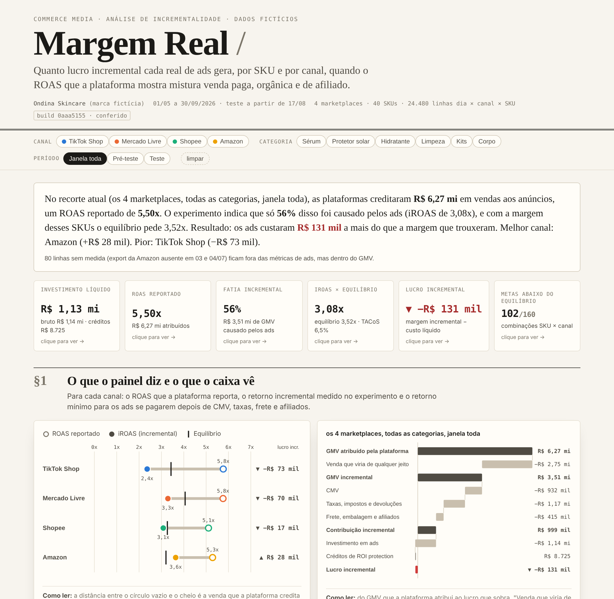

# Margem Real · incremental profit of marketplace ads

**[Live dashboard](https://diegosantm.github.io/margem-real-commerce-media/)** · [Português](#português) · SQL (DuckDB) · Python · single-file HTML



> **How much incremental profit does each R$1 of ads generate, per SKU and per channel, when the ROAS the platform shows mixes paid, organic and affiliate sales?**

Ondina Skincare is a fictitious beauty brand selling 40 SKUs on TikTok Shop, Mercado Livre, Shopee and Amazon (Brazil, May to Sep 2026). Every platform reports a healthy ROAS between 5.1x and 5.8x. A go-dark holdout test shows how much of that is real, and the brand's own order data shows what is left after costs.

## Key findings

| Channel | Spend | Platform ROAS | Measured iROAS (95% CI) | Incremental share (k) | Break-even iROAS | Incremental profit |
|---|---:|---:|---:|---:|---:|---:|
| TikTok Shop | R$ 261k | 5.77x | 2.25x (1.52 to 2.98) | 41% | 3.43x | **−R$ 72.6k** |
| Mercado Livre | R$ 367k | 5.76x | 3.31x (2.47 to 4.16) | 57% | 4.06x | **−R$ 69.7k** |
| Shopee | R$ 305k | 5.11x | 2.94x (2.24 to 3.64) | 60% | 3.27x | **−R$ 17.1k** |
| Amazon | R$ 206k | 5.29x | 3.74x (2.74 to 4.74) | 69% | 3.20x | **+R$ 28.0k** |
| **Total** | **R$ 1.14M** | **5.50x** | 3.08x | 56% | 3.52x | **−R$ 131.4k** |

* Platforms credited R$ 6.27M to ads; only **56%** of it was caused by ads. TikTok Shop GMV Max is the most inflated (k = 41%), which is consistent with how it attributes: same-day window, counting organic and affiliate orders on promoted products.
* **102 of 160** SKU × channel combinations run a target ROAS below their break-even. The platform delivers, reports a good number, and the brand loses margin.
* The 71 combinations that burn margin lose R$ 219k; the 45 profitable ones make R$ 85k. Fixing or pausing the losers moves the short-term result from −R$ 131k to roughly +R$ 88k.
* Two low-price SKUs on Mercado Livre have **negative contribution margin before any ad**: fixed fee plus seller shipping eat the whole ticket. No ROAS target can fix that.

## The method in one line

```
breakeven_platform_ROAS = 1 / (k × contribution_margin)
```

* **k** comes from the experiment: from 2026-08-17, in each channel, SKUs were paired by size and one of each pair had ads switched off. A ratio difference-in-differences estimator compares what the dark SKUs lost against the trend of the SKUs that kept ads. Uncertainty comes from a leave-one-SKU-out **jackknife written in SQL**.
* **Contribution margin** comes from the OMS (the financial source of truth): gross revenue minus COGS, refunds, marketplace fee, tax, fixed fee, seller shipping, packaging and affiliate commission.
* The result is the number to type into GMV Max / Custom ROAS, or the maximum ACOS (= k × cm) for teams that think in ACOS.

## Proof that the method works

The data is synthetic, so the generator knows the true answer (it plants the real iROAS and k in `data/truth/planted_truth.json`, which the SQL never reads). Validation checks that the experiment recovers it: **the true value falls inside the 95% interval in all 4 channels, for both iROAS and k.**

`validation/validate.py` runs **34 checks** in three families:

* **Integrity:** unique grain, 100% listing mapping, Shopee duplicate re-download removed, Mercado Ads Brazilian format parsed (`;`, `DD/MM/YYYY`, decimal comma), Amazon's two missing export days kept as *no measurement* (never zero), experiment balance.
* **Logic:** independent recomputation from the raw CSVs with pandas, TikTok ROI protection credits recomputed from the published rule and matched to the statement to the cent, waterfall closure, break-even identity, hand-calculated test cases.
* **Recovery:** planted truth inside the confidence interval.

The dashboard then **recomputes every number in the browser from the 24,480 daily rows** and shows a SQL × JavaScript table (27 metrics, tolerance down to 1e-9) plus a build fingerprint that flags a stale or truncated data block.

## Platform context (validated October 2026)

* **TikTok Shop:** since July 2025, GMV Max (Product GMV Max and LIVE GMV Max) is the only campaign type that can be created for Shop Ads. Product GMV Max uses a one-day, same-day window and includes organic and affiliate orders on promoted products. ROI protection (from Feb 25, 2026) credits the gap when daily ROI falls below 90% of target with more than 20 orders and no manual target edit. Sources: [TikTok GMV Max](https://ads.tiktok.com/business/en-US/blog/gmv-max-automate-shop-roi), [guide summarizing TikTok's help center](https://www.enrichlabs.ai/blog/tiktok-shop-ads-complete-guide-2026).
* **Amazon Ads:** Sponsored Products and Sponsored Brands (now with AI collections and prompts), Sponsored Display folded into display ads, DSP under Brand+ / Performance+. Report columns follow the Sponsored Products advertised product report (`cost`, `sales7d`, `purchases7d`). Source: [Amazon Ads announcements](https://advertising.amazon.com/resources/whats-new/unboxed-2025-sponsored-products-and-sponsored-brands-prompts).
* **Mercado Ads:** Product Ads (CPC) per MLB listing, read through ACOS / TACOS / ROAS.
* **Shopee Ads:** GMV Max Auto Bidding and GMV Max Custom ROAS. Source: [Shopee Ads FAQ](https://ads.shopee.sg/learn/faq/519/2015).

Fees, shipping and commissions in this project are **illustrative assumptions** for a fictitious brand, not real platform tariffs.

## Repository

```
generator/generate_data.py   synthetic data with platform-specific export quirks + planted truth
data/raw/                    12 raw files exactly as each platform / OMS would export them
data/truth/                  ground truth used only by validation
sql/01_raw.sql               land everything as it arrives
sql/02_staging.sql           one grain, one vocabulary; dedup, parsing, mapping, coverage
sql/03_core.sql              fct_sku_channel_day + ROI protection recomputed from the rules
sql/04_mart_experiment.sql   ratio DiD + leave-one-out jackknife in pure SQL
sql/05_mart_unit_economics.sql  break-even ROAS, verdict and action per SKU × channel
sql/06_mart_scorecard.sql    channel scorecard, profit waterfall, ROI protection summary
validation/validate.py       34 checks -> validation_report.md
dashboard/                   template + builder -> docs/index.html (GitHub Pages)
run_pipeline.py              runs everything end to end
```

## Run it

```bash
pip install -r requirements.txt
python run_pipeline.py --regen     # generate data, build warehouse, validate, build dashboard
```

Open `docs/index.html` (works offline, double click). Everything is deterministic (fixed seed).

## Limitations

* Short-term effect only: organic rank gains, repeat purchase and cross-channel spillover (a buyer moving from TikTok to Mercado Livre when ads stop) are not measured.
* One k per channel. Real campaigns vary by SKU, season and creative; with more SKUs the test could estimate k by category.
* Returned units are treated as lost (conservative).

---

## Português

**[Dashboard ao vivo](https://diegosantm.github.io/margem-real-commerce-media/)**

> **Quanto lucro incremental cada real de ads gera, por SKU e por canal, quando o ROAS que a plataforma mostra mistura venda paga, orgânica e de afiliado?**

A Ondina Skincare é uma marca fictícia de beleza com 40 SKUs vendidos em TikTok Shop, Mercado Livre, Shopee e Amazon (maio a setembro de 2026). Todas as plataformas reportam ROAS entre 5,1x e 5,8x. Um teste de holdout (desligar os ads de metade dos SKUs) mostra quanto disso é real, e o OMS da marca mostra o que sobra depois dos custos.

### O que os dados mostram

* As plataformas creditaram R$ 6,27 mi aos ads, mas só **56%** disso foi causado pelos ads. O TikTok Shop GMV Max é o mais inflado (k = 41%), coerente com a forma de atribuir: janela de um dia e pedidos orgânicos e de afiliados dos produtos promovidos entram na conta.
* Com R$ 1,14 mi investidos, o **lucro incremental foi de −R$ 131 mil**. Só a Amazon fechou no positivo (+R$ 28 mil).
* **102 de 160** combinações SKU × canal rodam com meta de ROAS abaixo do equilíbrio.
* As 71 combinações que queimam margem perdem R$ 219 mil; as 45 que lucram ganham R$ 85 mil. Ajustar ou pausar as perdedoras leva o resultado de curto prazo de −R$ 131 mil para cerca de +R$ 88 mil.
* Dois SKUs baratos no Mercado Livre têm **margem negativa antes de qualquer anúncio**: tarifa fixa e frete comem o tíquete inteiro.

### O método

```
ROAS_de_equilíbrio_na_plataforma = 1 / (k × margem_de_contribuição)
```

* **k** sai do experimento: a partir de 17/08, em cada canal, os SKUs foram pareados por tamanho e um de cada par teve os ads desligados. Um estimador de diferenças em diferenças por razão compara o que os SKUs apagados perderam com a tendência dos que seguiram com ads. A incerteza vem de um **jackknife (deixa um SKU de fora) escrito em SQL**.
* **Margem de contribuição** sai do OMS: receita bruta menos CMV, devoluções, taxa do marketplace, imposto, tarifa fixa, frete pago pelo vendedor, embalagem e comissão de afiliado.
* O resultado é o número para digitar no GMV Max / Custom ROAS, ou o ACOS máximo (= k × margem) para quem trabalha com ACOS.

### Prova de que o método funciona

Como a base é sintética, o gerador sabe a resposta certa e grava em `data/truth/` (o SQL nunca lê esse arquivo). A validação confere se o experimento recupera essa verdade: **o valor real cai dentro do intervalo de 95% nos 4 canais, para iROAS e para k.** São **34 checagens** automáticas (integridade, lógica com recálculo independente em pandas, casos-teste calculados à mão e recuperação da verdade), e o dashboard recalcula tudo no navegador a partir das 24.480 linhas diárias, comparando 27 métricas com o SQL.

### Como rodar

```bash
pip install -r requirements.txt
python run_pipeline.py --regen
```

Abra `docs/index.html` (funciona offline). Tudo é determinístico (semente fixa).

### Limitações

Mede só efeito de curto prazo (ranking orgânico, recompra e migração entre canais ficam de fora), usa um k por canal e trata unidade devolvida como perdida. Taxas, fretes e comissões são premissas ilustrativas de uma marca fictícia, não tarifas reais.

---

Diego · Paid media → data analytics · [github.com/diegosantm](https://github.com/diegosantm) · MIT License
